# Práctica de Monitorización en Linux

El objetivo de esta práctica es documentar y utilizar las principales herramientas de monitorización en sistemas Linux, interpretando la información de rendimiento y funcionamiento del servidor.

## 1. Procesos y CPU

### ps
* **Nombre y finalidad:** `ps` (Process Status) muestra una instantánea de los procesos actuales del sistema.
* **Sintaxis:** `ps aux`
  * `a`: Muestra los procesos de todos los usuarios.
  * `u`: Muestra el usuario y el formato detallado (uso de CPU y memoria).
* **Captura de pantalla:**
  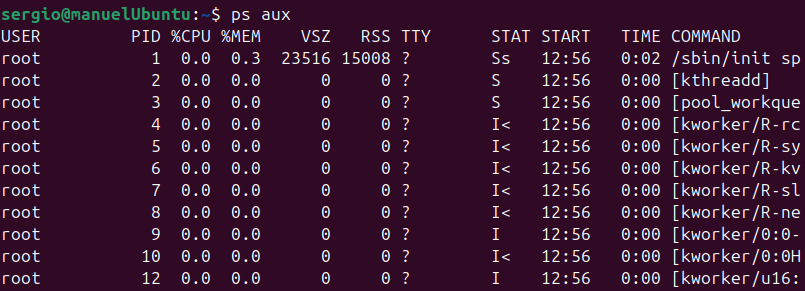
* **Interpretación:** Muestra el PID (identificador), porcentaje de CPU y memoria RAM que consume cada proceso en ese instante. Un administrador lo utiliza para identificar rápidamente procesos colgados o que consumen demasiados recursos.

### top
* **Nombre y finalidad:** Muestra los procesos del sistema en tiempo real.
* **Sintaxis:** `top -d 2`
  * `-d 2`: Actualiza la información cada 2 segundos.
  * `-u root`: Muestra solo los procesos del usuario root.
* **Captura de pantalla:**
  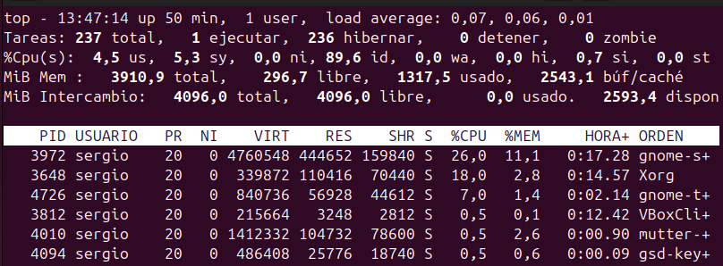
* **Interpretación:** Proporciona un resumen dinámico del sistema (uptime, carga, uso de CPU y RAM total) y una lista de procesos ordenada por consumo. Es la herramienta principal para la monitorización en vivo.

### htop
* **Instalación:** `sudo apt install htop`
* **Nombre y finalidad:** Es una versión interactiva y visualmente mejorada de `top`.
* **Sintaxis:** `htop -d 10`
  * `-d 10`: Retraso de actualización en décimas de segundo (1 segundo).
  * `F4`: Permite filtrar procesos por nombre de forma interactiva (se usa dentro del programa).
* **Captura de pantalla:**
  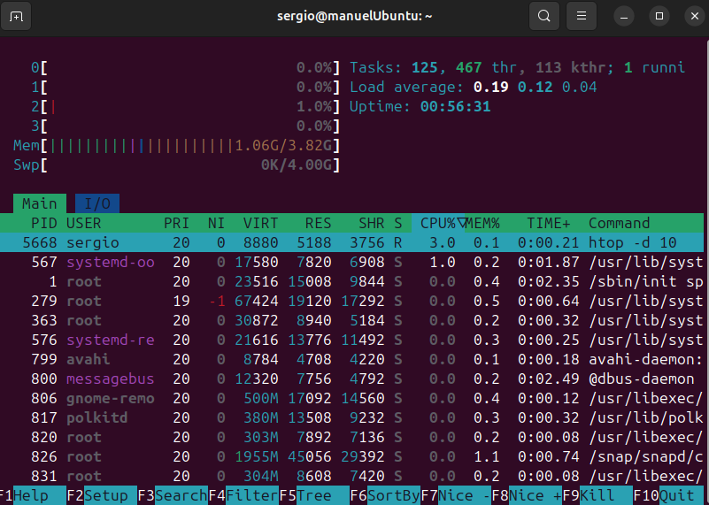
* **Interpretación:** Muestra barras de colores para el uso de cada núcleo de CPU, RAM y Swap. Permite al administrador matar procesos (F9) o cambiar su prioridad de forma gráfica e intuitiva.

### atop
* **Instalación:** `sudo apt install atop`
* **Nombre y finalidad:** Monitor de rendimiento avanzado que registra el uso histórico de recursos a nivel de sistema y procesos.
* **Sintaxis:** `atop -c`
  * `-c`: Muestra la línea de comandos completa de cada proceso.
  * `-m`: Ordena los procesos por consumo de memoria.
* **Captura de pantalla:**
  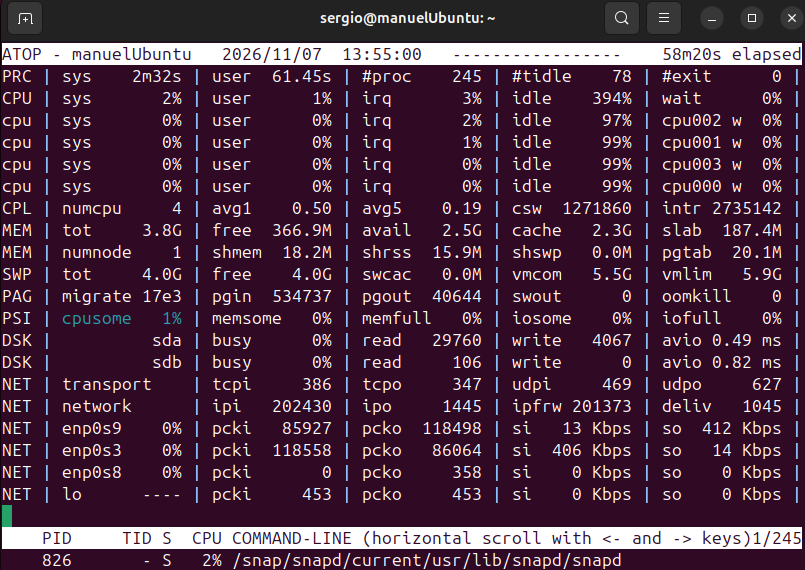
* **Interpretación:** Resalta en colores (como rojo) los recursos que están sobrecargados (CPU, disco, red). Es muy útil para análisis forense de rendimiento y descubrir cuellos de botella temporales.

---

## 2. Memoria RAM

### free
* **Nombre y finalidad:** Muestra la cantidad de memoria RAM y Swap libre y usada en el sistema.
* **Sintaxis:** `free -h`
  * `-h`: Muestra los valores en formato legible para humanos (MB, GB).
  * `-s 3`: Actualiza la salida cada 3 segundos continuamente.
* **Captura de pantalla:**
  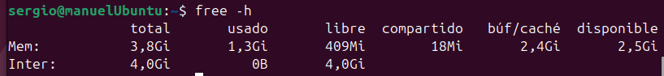
* **Interpretación:** Indica el total de RAM, la usada, la libre y la destinada a caché/buffers. El administrador lo usa para comprobar si el sistema se está quedando sin memoria o si está utilizando demasiada memoria de intercambio (Swap).

---

## 3. Almacenamiento

### df
* **Nombre y finalidad:** `df` (Disk Free) informa sobre el espacio de disco utilizado y disponible en los sistemas de archivos montados.
* **Sintaxis:** `df -hT`
  * `-h`: Formato legible para humanos (GB, MB).
  * `-T`: Imprime el tipo de sistema de archivos (ext4, tmpfs, etc.).
* **Captura de pantalla:**
  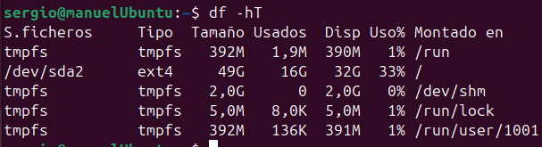
* **Interpretación:** Muestra qué porcentaje de cada disco o partición está lleno. Vital para evitar que un servidor se caiga por falta de espacio en disco.

### du
* **Nombre y finalidad:** `du` (Disk Usage) estima el espacio que ocupa un archivo o directorio específico.
* **Sintaxis:** `du -sh /var/log`
  * `-s`: Muestra solo el total resumido del directorio indicado.
  * `-h`: Formato legible (KB, MB, GB).
* **Captura de pantalla:**
  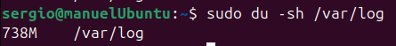
* **Interpretación:** Permite localizar qué carpetas exactas están consumiendo el almacenamiento (por ejemplo, para limpiar logs antiguos).

### iostat
* **Instalación:** `sudo apt install sysstat`
* **Nombre y finalidad:** Reporta estadísticas sobre la carga del procesador y las operaciones de entrada/salida (I/O) de los discos.
* **Sintaxis:** `iostat -xz 2`
  * `-x`: Muestra estadísticas extendidas detalladas.
  * `-z`: Omite los dispositivos sin actividad.
* **Captura de pantalla:**
  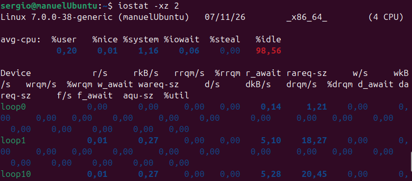
* **Interpretación:** Muestra la tasa de lectura/escritura y el tiempo de espera del disco (`%iowait`). Sirve para diagnosticar si un disco lento está limitando el rendimiento del servidor.

---

## 4. Tráfico de Red

### tcpdump
* **Instalación:** Suele venir preinstalado, si no: `sudo apt install tcpdump`
* **Nombre y finalidad:** Analizador de paquetes de red desde la línea de comandos. Captura el tráfico que pasa por una interfaz.
* **Sintaxis:** `sudo tcpdump -i enp0s3 -c 10`
  * `-i`: Especifica la interfaz de red a escuchar.
  * `-c 10`: Captura exactamente 10 paquetes y se detiene.
* **Captura de pantalla:**
  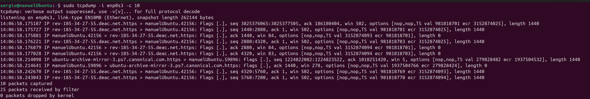
* **Interpretación:** Muestra las cabeceras de los paquetes interceptados (IP de origen y destino, puertos). Se usa para depurar problemas de conectividad o detectar tráfico anómalo.

### tcptrack
* **Instalación:** `sudo apt install tcptrack`
* **Nombre y finalidad:** Muestra información en vivo de las conexiones TCP, similar a la interfaz de `top`.
* **Sintaxis:** `sudo tcptrack -i enp0s3`
  * `-i`: Especifica la interfaz a monitorizar.
  * `port 80`: (opcional al final) Filtra para ver solo tráfico HTTP.
* **Captura de pantalla:**
  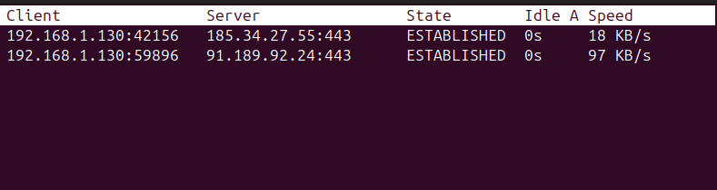
* **Interpretación:** Muestra las conexiones activas, su estado (ESTABLISHED, TIME_WAIT) y la velocidad en bytes por segundo. Útil para ver quién está consumiendo el ancho de banda.

### iptraf (iptraf-ng)
* **Instalación:** `sudo apt install iptraf-ng`
* **Nombre y finalidad:** Monitor de red interactivo basado en menús que genera estadísticas de tráfico IP, TCP, UDP y fallos de red.
* **Sintaxis:** `sudo iptraf-ng -i all`
  * `-i all`: Inicia el monitor IP para todas las interfaces de red de forma directa.
  * `-B`: Se ejecuta en segundo plano.
* **Captura de pantalla:**
  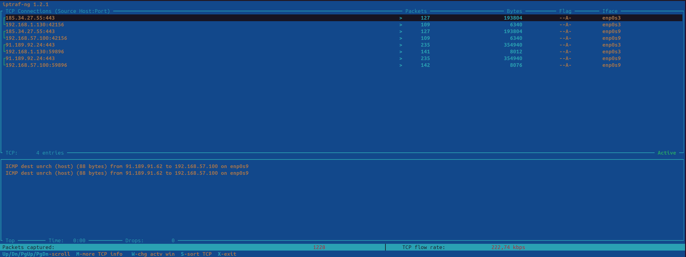
* **Interpretación:** Ofrece una vista completa de los paquetes que entran y salen ordenados por conexión. Ideal para monitorizar ruteo y cuellos de botella en la red local.

### bmon
* **Instalación:** `sudo apt install bmon`
* **Nombre y finalidad:** Monitor de ancho de banda y estimador de tasas.
* **Sintaxis:** `bmon -p enp0s3`
  * `-p`: Filtra para mostrar solo la interfaz especificada.
  * `-b`: Muestra la interfaz gráfica con gráficos de barras en ASCII.
* **Captura de pantalla:**
  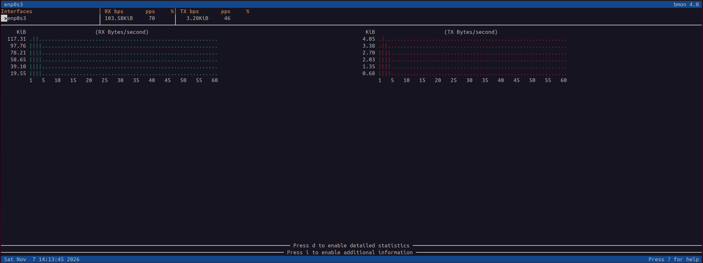
* **Interpretación:** Representa de forma gráfica y en tiempo real el tráfico Rx (recibido) y Tx (transmitido). Es la forma más rápida de ver el uso general del ancho de banda.

---

## 5. Puertos y Conexiones

### ss
* **Nombre y finalidad:** Herramienta para investigar los sockets (reemplazo moderno de `netstat`).
* **Sintaxis:** `ss -tuln`
  * `-t` y `-u`: Muestra sockets TCP y UDP.
  * `-l`: Muestra solo los puertos en estado de escucha (listening).
  * `-n`: No resuelve los nombres de host (muestra las IPs numéricas).
* **Captura de pantalla:**
  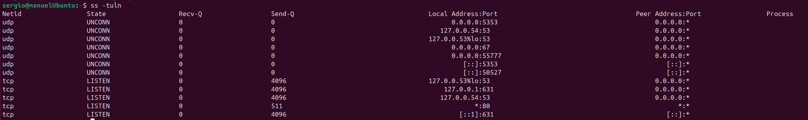
* **Interpretación:** Enumera qué puertos del servidor están abiertos y esperando conexiones. Fundamental para la seguridad y para verificar que servicios como el servidor web (80) están funcionando.

### nmap
* **Instalación:** `sudo apt install nmap`
* **Nombre y finalidad:** Escáner de red y puertos para descubrir hosts y servicios en una red informática.
* **Sintaxis:** `nmap -sV 127.0.0.1`
  * `-sV`: Intenta determinar la versión del servicio que corre en cada puerto abierto.
  * `-p 1-1000`: Escanea solo el rango de puertos especificado.
* **Captura de pantalla:**
  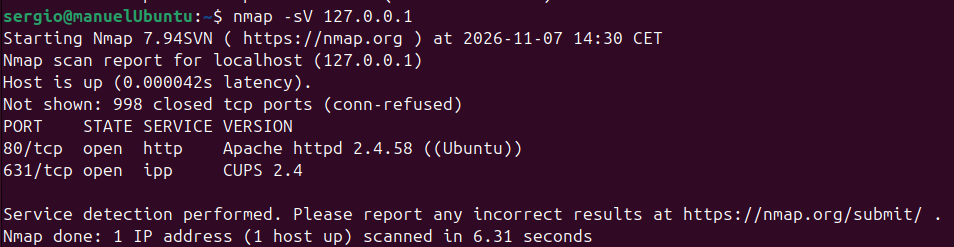
* **Interpretación:** Muestra desde una perspectiva externa (auditoría) qué puertos están abiertos, filtrados o cerrados. Se utiliza para pentesting y verificar reglas de firewall.

---

## 6. Análisis de resultados

**1. ¿Cómo comprobarías la cantidad de memoria RAM disponible?**
Utilizando el comando `free -h`. El valor disponible real para iniciar nuevas aplicaciones se encuentra en la columna "available". También se puede ver de forma dinámica abriendo `htop` o `top`.

**2. ¿Qué diferencia existe entre df y du?**
`df` se utiliza para ver el espacio total, usado y disponible a nivel de *sistemas de archivos o particiones enteras* (ej. cuánto espacio le queda al disco duro). `du` se utiliza para calcular cuánto espacio en disco consume un *archivo o directorio específico* (ej. cuánto pesa la carpeta de usuario).

**3. ¿Qué diferencias existen entre ss y nmap?**
`ss` es una herramienta de consulta local; pregunta al propio sistema operativo qué puertos tiene abiertos y qué conexiones activas posee. `nmap` es una herramienta de escaneo de red que funciona enviando paquetes desde fuera hacia una IP (puede ser remota) para inferir qué puertos están abiertos basándose en la respuesta, actuando como un auditor externo.

**4. ¿Cómo comprobarías si un servidor tiene abierto el puerto 80?**
Si estoy dentro del propio servidor, usaría: `ss -tuln | grep :80`. Si lo quiero comprobar desde otro equipo en la red (para asegurar que el firewall no lo bloquea), usaría: `nmap -p 80 <IP_del_servidor>`.

**5. ¿Qué herramienta utilizarías para detectar un posible cuello de botella en el disco?**
Utilizaría `iostat -x 2` para observar el porcentaje de tiempo de inactividad de la CPU debido a esperas de disco (`%iowait`) y el grado de utilización del propio disco (`%util`). Otra excelente opción es utilizar `atop` que resalta en rojo los discos saturados.

**6. ¿Por qué es importante monitorizar los recursos de un servidor?**
Para prevenir caídas del sistema anticipando el agotamiento de recursos (como discos llenos o falta de RAM), optimizar el rendimiento identificando procesos ineficientes, detectar posibles ataques de seguridad o anomalías en el tráfico de red, y planificar con tiempo cuándo es necesario ampliar el hardware del servidor.
